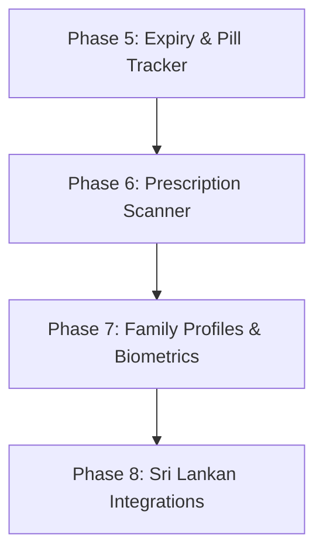

# 📋 MedScan AI — Development Roadmap & Feature Plan v2.0 (plan.md)

This document outlines the strategic engineering roadmap and feature specification for **MedScan AI v2.0**. It builds upon the verified foundation (Gemini 3.7 Vision, Bilingual Sinhala/English OCR, SQLite Local Database, and Audio Voice Reader) to transform the application into an all-in-one clinical health-tech assistant.

---

## 🏆 Current Progress & Implemented Milestone (v1.0 - Done)

- [x] **Core Vision AI**: Multimodal scanning via Google Gemini (`gemini-3.7-flash` / `gemini-3.5-flash`) with automatic 503 backoff retry.
- [x] **Bilingual Clinical Extraction**: 7 core medical fields formatted in pure Sinhala (සිංහල) and English.
- [x] **Voice Reader (TTS)**: High-fidelity audio playback bar in `ResultScreen`.
- [x] **Hospital-Grade PDF Export**: Clinical summary generation and printing via `pdf` and `printing`.
- [x] **Permanent Local SQLite Database**: Offline medicine storage (`mediscan_vault.db`) via `sqflite` with real-time search & favorites.
- [x] **Drug-to-Drug Interaction Checker**: Dual-medicine comparison screen for adverse interaction risks.
- [x] **Dosage Reminders**: Scheduled notifications for Morning, Afternoon, and Night alarms.
- [x] **Sri Lanka Emergency Directory**: 1-tap dialers for 1990 Suwa Seriya, National Poisons Centre (011-2686143), and NHSL.
- [x] **UI & Memory Optimization**: `android:largeHeap="true"` and camera `retrieveLostData()` crash prevention.

---

## 🧭 Milestone Overview (v2.0)

| Phase | Focus Area | Key Deliverables | Priority |
| :--- | :--- | :--- | :--- |
| **Phase 5** | **Smart Expiry & Pill Inventory** | AI EXP Date Extractor, Expiry Alerts, Pill Count & Refill Alarms | ✅ Completed |
| **Phase 6** | **Handwritten Prescription Scanner** | Doctor Cursive OCR, Multi-Med Extraction, Batch Dose Scheduler | ✅ Completed |
| **Phase 7** | **Family Profiles & Biometric Security** | Multi-Member Cabinets, Fingerprint / Face Unlock (`local_auth`) | 🟡 Medium |
| **Phase 8** | **Sri Lankan Health-Tech Integrations** | SPC / Osu Sala Generic Alternatives, Food Warning Badges, Doctor Export | 🟢 Enhancement |

---

## 📅 Phase 5: Smart Expiry & Pill Inventory (කල් ඉකුත්වීමේ අනතුරු ඇඟවීම්)

### 5.1 AI Expiry Date & Batch Number Extractor
* **Goal**: Automatically read `EXP`, `MFD`, and `Batch No` printed on blister strips, boxes, or bottle rims and store them in the phone's database.
* **Architecture**:
  - Update Gemini prompt to identify expiry dates across varied global formats (`MM/YY`, `EXP: 12/2027`, `MAY 28`).
  - Add `expiry_date INTEGER` and `batch_no TEXT` columns to SQLite table `medicines`.
  - Calculate days remaining until expiry.

### 5.2 Automated Expiry Push Notifications
* **Goal**: Prevent accidental consumption of expired pharmaceuticals.
* **Architecture**:
  - Automatically schedule local push notifications via `flutter_local_notifications`:
    - **Alert 1**: 30 days before expiration (*"Your Panadol Extra will expire in 30 days"*).
    - **Alert 2**: 7 days before expiration (*"Warning: Medicine expiring this week. Discard safely."*).
  - Highlight expiring items in the Medicine Cabinet with a distinct Amber/Red badge.

### 5.3 Pill Inventory Counter & Refill Alarm
* **Goal**: Track remaining tablet count and alert patients before running out.
* **Architecture**:
  - User specifies starting count (e.g. 10 tablets).
  - Tapping "Mark Dose Taken" automatically decrements the inventory.
  - When remaining pills $\le 2$, triggers a refill alert: *"Panadol Extra running low — visit your pharmacy"*.

---

## 📝 Phase 6: Handwritten Doctor's Prescription Scanner (බෙහෙත් තිණ්ඩු OCR)

### 6.1 Prescription Mode Viewfinder
* **Goal**: Dedicated capture mode optimized for A4/A5 prescription papers and doctor slips.
* **Architecture**:
  - New "Prescription Scanner" card on `HomeScreen`.
  - Document perspective overlay with high-contrast document filter.

### 6.2 Gemini Cursive Medical Handwriting Decoder
* **Goal**: Accurately decipher doctors' cursive handwriting and Latin clinical abbreviations.
* **Architecture**:
  - Specialized multimodal prompt tailored for medical prescription recognition:
    - Identifies each drug line-by-line.
    - Decodes frequency abbreviations: `o.d.` (daily), `b.d.` (twice daily), `t.d.s.` (thrice daily), `q.d.s.` (four times daily), `p.r.n.` (as needed), `nocte` (at night).
    - Decodes duration (e.g. `x 5/7` = 5 days, `x 1/12` = 1 month).
  - Returns structured JSON array of all medicines in both Sinhala and English.

### 6.3 1-Tap Batch Dose Scheduler
* **Goal**: Set up an entire prescription's reminder alarms with a single click.
* **Architecture**:
  - Review screen presenting the scanned prescription checklist.
  - User confirms meal times; system schedules recurring notification alarms for all prescribed medications simultaneously.

---

## 👨‍👩‍👧‍👦 Phase 7: Family Health Profiles & Biometric Security (පවුලේ සාමාජිකයන් සහ ආරක්ෂාව)

### 7.1 Multi-Member Family Cabinets
* **Goal**: Prevent mixing up elderly parents', children's, and personal medications.
* **Architecture**:
  - Create custom profiles: e.g. **තාත්තා (Father)**, **අම්මා (Mother)**, **මම (Self)**, **බබා (Baby)**.
  - Store `profile_id` in SQLite database.
  - Quick-switch profile filter tabs in `HistoryScreen`.

### 7.2 Biometric App Lock (Fingerprint & Face Unlock)
* **Goal**: Ensure confidential patient health records and prescription histories remain private.
* **Target Package**: `local_auth: ^2.3.0`
* **Architecture**:
  - Settings toggle: "Enable Biometric Security".
  - Prompts device fingerprint or face recognition upon launching the Medicine Cabinet.

---

## 🇱🇰 Phase 8: Sri Lankan Health-Tech Integrations (ලංකාවේ ඖෂධ සහ ආහාර ගැටීම්)

### 8.1 SPC / Rajya Osu Sala Generic Alternatives (ලාභදායී ආදේශක ඖෂධ)
* **Goal**: Help patients find affordable, high-quality generic alternatives when branded medicines are costly or out of stock.
* **Architecture**:
  - AI identifies the active chemical compound (e.g. *Augmentin $\rightarrow$ Co-Amoxiclav*).
  - Recommends approved Sri Lankan SPC (State Pharmaceuticals Corporation) / Osu Sala equivalents.

### 8.2 Food & Beverage Contraindication Badges
* **Goal**: Visually highlight critical dietary cautions alongside usage instructions.
* **Architecture**:
  - Visual iconography on `ResultScreen`:
    - 🥛 **Dairy / Milk**: Avoid with certain tetracyclines / fluoroquinolones.
    - ☕ **Tea / Coffee**: Avoid within 2 hours of Iron supplements.
    - 🍷 **Alcohol**: Strict contraindication with Metronidazole / sedatives.
    - 🍽️ **Meal Timing**: Before meals, With meals, or After meals.

### 8.3 1-Tap Doctor WhatsApp / Email Summary
* **Goal**: Instantly export active prescriptions to a doctor or clinic prior to consultation.
* **Architecture**:
  - Compiles all active medications in SQLite into an encrypted summary PDF.
  - Uses `share_plus` to launch WhatsApp / Email with pre-filled clinical details.

---

## 🛠️ Step-by-Step Execution Plan

### Next Implementation Steps:
1. **Step 1**: Expand SQLite schema in `database_service.dart` with `expiry_date`, `batch_no`, and `pill_count`.
2. **Step 2**: Update `gemini_service.dart` prompt to extract expiry dates and dietary contraindications.
3. **Step 3**: Build Expiry Notification Scheduler and Expiry Badge in Medicine Cabinet.
4. **Step 4**: Introduce Prescription Scanner mode with handwriting OCR.
5. **Step 5**: Integrate `local_auth` for Biometric Lock and Family Profiles.
